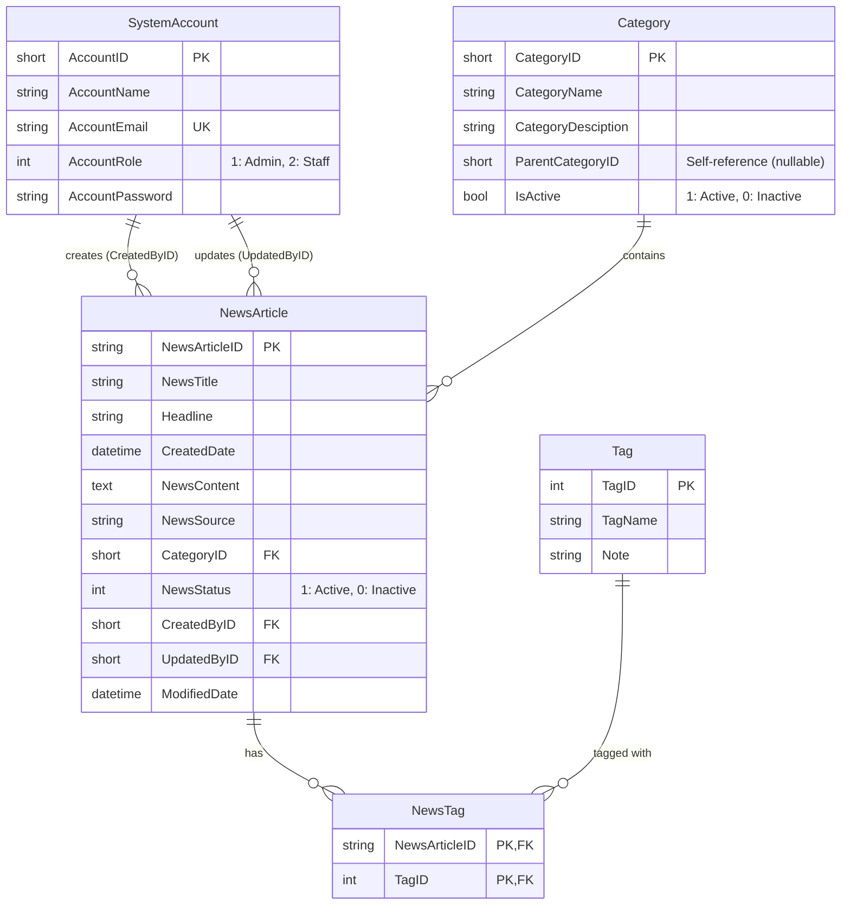
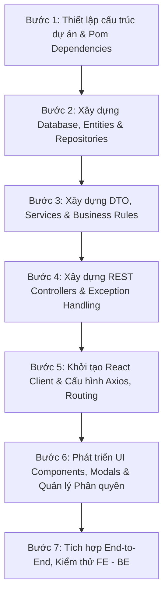

# TÀI LIỆU THIẾT KẾ KIẾN TRÚC & HƯỚNG DẪN THỰC HIỆN ASSIGNMENT 02
## ĐỀ TÀI: FUNewsManagementSystem (SBA301)
**Hệ thống Quản lý Tin tức (News Management System - NMS)**
**Công nghệ:** Spring Boot 3 (3-Layer Architecture, Spring Data JPA, MS SQL Server) + ReactJS (Axios, Component Modals)

---

## 1. TỔNG QUAN YÊU CẦU ĐỀ BÀI (ASSIGNMENT REQUIREMENTS)

### 1.1. Mục tiêu bài toán
Hệ thống **FUNewsManagementSystem** hỗ trợ trường đại học/tổ chức giáo dục quản lý bài viết tin tức và tài khoản hệ thống.
Hệ thống gồm 2 thành phần chính:
- **Backend**: Cung cấp chuẩn RESTful Web Service sử dụng **Spring Boot 3** theo mô hình **3-Layer Architecture** kết nối cơ sở dữ liệu **MS SQL Server** qua **Spring Data JPA**.
- **Frontend**: Ứng dụng Single Page Application (SPA) xây dựng bằng **ReactJS**, giao tiếp API thông qua thư viện **Axios**.

---

### 1.2. Phân quyền và Chức năng theo vai trò (Roles & Privileges)

Hệ thống có 3 nhóm người dùng:

| Vai trò (Role) | Mã quyền (Role ID) | Quyền hạn và Chức năng |
| :--- | :---: | :--- |
| **Khách (Guest / Public)** | N/A | - Xem danh sách tin tức công khai.<br>- Xem chi tiết bài viết tin tức.<br>- **Lưu ý:** Chỉ xem được các tin có `NewsStatus = 1` (Active). Không cần đăng nhập. |
| **Quản trị viên (Admin)** | `1` | - Đăng nhập hệ thống bằng Email & Password.<br>- **Quản lý tài khoản (Account Management):** Xem danh sách, tìm kiếm, thêm mới, cập nhật, xóa tài khoản.<br>- **Ràng buộc nghiệp vụ xóa:** Chỉ cho phép xóa tài khoản **chưa từng tạo bài viết tin tức nào**. Nếu tài khoản đã tạo ít nhất 1 bài viết, hệ thống chặn xóa và thông báo lỗi. |
| **Nhân viên (Staff)** | `2` | - Đăng nhập hệ thống bằng Email & Password.<br>- **Quản lý danh mục (Category Management):** CRUD + Search danh mục.<br>  * *Ràng buộc nghiệp vụ xóa:* Chỉ cho phép xóa danh mục **chưa chứa bài viết nào**. Nếu danh mục đã có bài viết, chặn xóa.<br>- **Quản lý tin tức (News Article Management):** CRUD + Search tin tức (bao gồm gán và cập nhật danh sách Tags).<br>- **Quản lý thông tin cá nhân (Profile Management):** Xem và cập nhật thông tin cá nhân của chính mình.<br>- **Lịch sử tin tức (News History):** Xem danh sách các bài viết do chính nhân viên đó tạo (`CreatedByID = CurrentUser.AccountID`). |

---

### 1.3. Yêu cầu Giao diện & Trải nghiệm (UI/UX Constraints)
- **Modal / Popup Dialog:** Thao tác **Tạo mới (Create)** và **Cập nhật (Update)** trên các màn hình Account, Category, News Article **bắt buộc** phải sử dụng Popup Dialog (Modal), không chuyển trang.
- **Confirmation Dialog:** Thao tác **Xóa (Delete)** **bắt buộc** phải có hộp thoại xác nhận (Yes/No confirm) trước khi gửi yêu cầu xóa đến Server.
- **Search:** Hỗ trợ tìm kiếm theo từ khóa (tiêu đề bài viết, tên tài khoản, tên danh mục).
- **Validation:** Kiểm tra hợp lệ dữ liệu (required, định dạng email, độ dài, kiểu dữ liệu) ở cả Client-side và Server-side.

---

## 2. THIẾT KẾ CƠ SỞ DỮ LIỆU (DATABASE DESIGN)

Tên Database quy định: `A2StudentName_ClassCode` (Ví dụ: `A2NguyenVanA_SE1701`).

### 2.1. Sơ đồ thực thể liên kết (ERD)



### 2.2. Chi tiết các bảng (Data Dictionary)

#### 1. Bảng `SystemAccount`
| Cột | Kiểu dữ liệu | Ràng buộc | Mô tả |
| :--- | :--- | :--- | :--- |
| `AccountID` | `SMALLINT` / `SHORT` | PRIMARY KEY, IDENTITY | Mã định danh tài khoản |
| `AccountName` | `NVARCHAR(100)` | NOT NULL | Tên người dùng |
| `AccountEmail` | `VARCHAR(150)` | UNIQUE, NOT NULL | Email đăng nhập |
| `AccountRole` | `INT` | NOT NULL | 1: Admin, 2: Staff |
| `AccountPassword` | `VARCHAR(255)` | NOT NULL | Mật khẩu (mã hóa BCrypt hoặc plain text có kiểm tra) |

#### 2. Bảng `Category`
| Cột | Kiểu dữ liệu | Ràng buộc | Mô tả |
| :--- | :--- | :--- | :--- |
| `CategoryID` | `SMALLINT` | PRIMARY KEY, IDENTITY | Mã danh mục |
| `CategoryName` | `NVARCHAR(150)` | NOT NULL | Tên danh mục |
| `CategoryDesciption`| `NVARCHAR(255)` | NULL | Mô tả danh mục |
| `ParentCategoryID` | `SMALLINT` | NULL, FK self | Danh mục cha (nếu có) |
| `IsActive` | `BIT` / `BOOLEAN` | DEFAULT 1 | 1: Hoạt động, 0: Ngưng hoạt động |

#### 3. Bảng `Tag`
| Cột | Kiểu dữ liệu | Ràng buộc | Mô tả |
| :--- | :--- | :--- | :--- |
| `TagID` | `INT` | PRIMARY KEY, IDENTITY | Mã nhãn |
| `TagName` | `NVARCHAR(100)` | NOT NULL | Tên nhãn |
| `Note` | `NVARCHAR(255)` | NULL | Ghi chú nhãn |

#### 4. Bảng `NewsArticle`
| Cột | Kiểu dữ liệu | Ràng buộc | Mô tả |
| :--- | :--- | :--- | :--- |
| `NewsArticleID` | `VARCHAR(20)` | PRIMARY KEY | Mã bài viết tin tức (chuỗi định danh) |
| `NewsTitle` | `NVARCHAR(250)` | NOT NULL | Tiêu đề tin tức |
| `Headline` | `NVARCHAR(255)` | NULL | Dòng tóm tắt / tít phụ |
| `CreatedDate` | `DATETIME` | DEFAULT CURRENT_TIMESTAMP | Ngày tạo |
| `NewsContent` | `NVARCHAR(MAX)` | NOT NULL | Nội dung chi tiết bài viết |
| `NewsSource` | `NVARCHAR(150)` | NULL | Nguồn tin |
| `CategoryID` | `SMALLINT` | FK -> Category(CategoryID) | Thuộc danh mục |
| `NewsStatus` | `INT` / `BIT` | DEFAULT 1 | 1: Active (hiển thị), 0: Inactive (ẩn) |
| `CreatedByID` | `SMALLINT` | FK -> SystemAccount(AccountID) | Người tạo (Staff) |
| `UpdatedByID` | `SMALLINT` | FK -> SystemAccount(AccountID) | Người cập nhật gần nhất |
| `ModifiedDate` | `DATETIME` | NULL | Ngày chỉnh sửa gần nhất |

#### 5. Bảng `NewsTag`
| Cột | Kiểu dữ liệu | Ràng buộc | Mô tả |
| :--- | :--- | :--- | :--- |
| `NewsArticleID` | `VARCHAR(20)` | Composite PK, FK -> NewsArticle | Mã bài viết |
| `TagID` | `INT` | Composite PK, FK -> Tag | Mã tag liên kết |

---

## 3. THIẾT KẾ KIẾN TRÚC HỆ THỐNG (SYSTEM ARCHITECTURE)

### 3.1. Kiến trúc tổng thể (Client - Server Architecture)

```
+-------------------------------------------------------------------------+
|                           CLIENT (ReactJS)                              |
|  - UI Pages: Public News, Login, Admin Dashboard, Staff Dashboard       |
|  - Components: Modals (Create/Update), Confirm Dialogs (Delete)         |
|  - State Management: React Context (AuthContext)                        |
|  - HTTP Client: Axios Service with Interceptors                         |
+-------------------------------------------------------------------------+
                                    |
                                    | JSON over HTTPS (RESTful APIs)
                                    v
+-------------------------------------------------------------------------+
|                       BACKEND (Spring Boot 3)                           |
|                                                                         |
|  [Controller Layer]  - REST Controllers (@RestController)               |
|                      - Input Validation (@Valid)                        |
|                      - Authentication / Session Check                   |
|                                                                         |
|  [Service Layer]     - Business Logic & Constraint Validations          |
|                      - Transaction Management (@Transactional)          |
|                      - DTO Mapping                                      |
|                                                                         |
|  [Repository Layer]  - Spring Data JPA (JpaRepository)                  |
|                      - Custom Query Methods / Derived Queries           |
+-------------------------------------------------------------------------+
                                    |
                                    | Hibernate / JDBC Driver
                                    v
+-------------------------------------------------------------------------+
|                  DATABASE (Microsoft SQL Server)                        |
|  Tables: SystemAccount, Category, NewsArticle, Tag, NewsTag             |
+-------------------------------------------------------------------------+
```

---

### 3.2. Kiến trúc 3-Layer phía Backend (Spring Boot 3)

Mô hình 3 lớp chuẩn enterprise:
1. **Controller Layer (`com.nms.controller`)**:
   - Tiếp nhận HTTP requests (`GET`, `POST`, `PUT`, `DELETE`).
   - Validate dữ liệu đầu vào thông qua Jakarta Validation (`@NotBlank`, `@Email`, `@Size`...).
   - Trả về mã HTTP status chuẩn (`200 OK`, `201 Created`, `400 Bad Request`, `403 Forbidden`, `404 Not Found`, `409 Conflict`).
2. **Service Layer (`com.nms.service` & `com.nms.service.impl`)**:
   - Triển khai toàn bộ quy tắc nghiệp vụ (Business Rules).
   - Kiểm tra ràng buộc:
     * Trước khi xóa Account: gọi `newsArticleRepository.existsByCreatedByID(id)`. Nếu tồn tại -> ném `BusinessException("Cannot delete account: Account already created news articles.")`.
     * Trước khi xóa Category: gọi `newsArticleRepository.existsByCategoryID(id)`. Nếu tồn tại -> ném `BusinessException("Cannot delete category: Category contains active news articles.")`.
   - Quản lý giao dịch dữ liệu `@Transactional`.
3. **Repository Layer (`com.nms.repository`)**:
   - Giao diện kế thừa `JpaRepository<Entity, ID>`.
   - Thực thi các thao tác CRUD và truy vấn nâng cao (Search theo từ khóa bằng Derived Queries hoặc `@Query`).

#### Cấu trúc thư mục Backend:
```
backend/src/main/java/com/nms/
├── config/
│   ├── CorsConfig.java            # Cấu hình CORS cho phép React Client gọi API
│   └── WebConfig.java
├── controller/
│   ├── AuthController.java        # API Login, Current User
│   ├── AccountController.java     # API CRUD SystemAccount (Admin)
│   ├── CategoryController.java    # API CRUD Category (Staff)
│   ├── NewsArticleController.java # API CRUD NewsArticle (Public & Staff)
│   └── TagController.java         # API lấy danh sách Tags
├── dto/
│   ├── request/                   # DTO tiếp nhận dữ liệu từ Client
│   │   ├── LoginRequest.java
│   │   ├── AccountRequest.java
│   │   ├── CategoryRequest.java
│   │   └── NewsArticleRequest.java
│   └── response/                  # DTO trả về cho Client
│       ├── ApiResponse.java       # Wrapper response thống nhất {success, message, data}
│       ├── AuthResponse.java
│       ├── AccountResponse.java
│       ├── CategoryResponse.java
│       └── NewsArticleResponse.java
├── entity/
│   ├── SystemAccount.java
│   ├── Category.java
│   ├── Tag.java
│   └── NewsArticle.java
├── exception/
│   ├── BusinessException.java     # Lỗi nghiệp vụ (ràng buộc xóa, trùng email...)
│   ├── ResourceNotFoundException.java
│   └── GlobalExceptionHandler.java# Bắt lỗi toàn cục trả về JSON thống nhất
├── repository/
│   ├── SystemAccountRepository.java
│   ├── CategoryRepository.java
│   ├── TagRepository.java
│   └── NewsArticleRepository.java
└── service/
    ├── AccountService.java
    ├── CategoryService.java
    ├── NewsArticleService.java
    ├── TagService.java
    └── impl/
        ├── AccountServiceImpl.java
        ├── CategoryServiceImpl.java
        ├── NewsArticleServiceImpl.java
        └── TagServiceImpl.java
```

---

### 3.3. Thiết kế cấu trúc Frontend (ReactJS)

Ứng dụng React xây dựng theo hướng Component-Driven, module hóa rõ ràng:
- **Routing (`react-router-dom`)**:
  - `/` hoặc `/news`: Trang xem tin tức công khai (dành cho mọi người).
  - `/news/:id`: Xem chi tiết tin tức.
  - `/login`: Màn hình đăng nhập.
  - `/admin/accounts`: Màn hình Admin quản lý tài khoản.
  - `/staff/categories`: Màn hình Staff quản lý danh mục.
  - `/staff/articles`: Màn hình Staff quản lý tin tức.
  - `/staff/history`: Màn hình Staff xem lịch sử tin tức do chính mình viết.
  - `/staff/profile`: Màn hình Staff cập nhật thông tin cá nhân.
- **Context API (`AuthContext`)**:
  - Quản lý trạng thái đăng nhập, thông tin user hiện tại (`id`, `name`, `email`, `role`).
  - Hỗ trợ lưu trữ phiên đăng nhập (`localStorage`).
  - Bảo vệ các đường dẫn nhạy cảm (`ProtectedRoute` theo `role = 1` hoặc `role = 2`).
- **Thư viện giao diện & Components**:
  - Tận dụng hệ thống Modal/Dialog chuẩn: Tạo/Sửa trong Popup Dialog, Xác nhận Xóa trong Modal Confirm.

#### Cấu trúc thư mục Client:
```
client/src/
├── api/
│   ├── axiosClient.js          # Cấu hình Axios base URL, headers
│   ├── authApi.js
│   ├── accountApi.js
│   ├── categoryApi.js
│   ├── newsArticleApi.js
│   └── tagApi.js
├── components/
│   ├── common/
│   │   ├── Navbar.jsx          # Thanh điều hướng (menu động theo role)
│   │   ├── ConfirmModal.jsx    # Popup xác nhận hành động Xóa (Yes/No)
│   │   ├── ModalWrapper.jsx    # Hộp thoại Modal khung
│   │   └── ProtectedRoute.jsx  # Bảo vệ route theo vai trò Admin/Staff
│   ├── account/
│   │   ├── AccountModal.jsx    # Popup Tạo / Sửa Tài khoản
│   │   └── AccountTable.jsx
│   ├── category/
│   │   ├── CategoryModal.jsx   # Popup Tạo / Sửa Danh mục
│   │   └── CategoryTable.jsx
│   └── news/
│       ├── NewsArticleModal.jsx# Popup Tạo / Sửa Tin tức (chọn Category, chọn Tags)
│       └── NewsCard.jsx
├── context/
│   └── AuthContext.jsx         # Quản lý Auth State, Login, Logout
├── pages/
│   ├── public/
│   │   ├── PublicNewsPage.jsx  # Danh sách tin tức active
│   │   └── NewsDetailPage.jsx  # Chi tiết bài viết
│   ├── auth/
│   │   └── LoginPage.jsx       # Form đăng nhập
│   ├── admin/
│   │   └── AccountManagementPage.jsx
│   └── staff/
│       ├── CategoryManagementPage.jsx
│       ├── NewsManagementPage.jsx
│       ├── MyNewsHistoryPage.jsx
│       └── StaffProfilePage.jsx
├── App.jsx
└── main.jsx
```

---

## 4. CHI TIẾT THIẾT KẾ RESTFUL API (API SPECIFICATION)

### 4.1. Authentication APIs
| Method | Endpoint | Mô tả | Phân quyền | Request Body | Response |
| :--- | :--- | :--- | :--- | :--- | :--- |
| `POST` | `/api/auth/login` | Đăng nhập hệ thống | Public | `{ email, password }` | `{ accountId, accountName, accountEmail, accountRole }` |

---

### 4.2. Account Management APIs (Admin - Role 1)
| Method | Endpoint | Mô tả | Phân quyền | Body / Query |
| :--- | :--- | :--- | :--- | :--- |
| `GET` | `/api/accounts` | Lấy danh sách tài khoản (hỗ trợ search) | Admin | Query: `keyword` |
| `GET` | `/api/accounts/{id}` | Lấy chi tiết tài khoản theo ID | Admin | - |
| `POST` | `/api/accounts` | Tạo mới tài khoản | Admin | `{ accountName, accountEmail, accountRole, accountPassword }` |
| `PUT` | `/api/accounts/{id}` | Cập nhật tài khoản | Admin | `{ accountName, accountEmail, accountRole, accountPassword? }` |
| `DELETE`| `/api/accounts/{id}` | Xóa tài khoản (Kiểm tra constraint) | Admin | - |

> [!IMPORTANT]
> **Logic xóa Account**:
> ```java
> if (newsArticleRepository.existsByCreatedByID(accountId)) {
>     throw new BusinessException("Cannot delete account: This account has already created news articles.");
> }
> ```

---

### 4.3. Category Management APIs (Staff - Role 2)
| Method | Endpoint | Mô tả | Phân quyền | Body / Query |
| :--- | :--- | :--- | :--- | :--- |
| `GET` | `/api/categories` | Lấy toàn bộ danh mục (hỗ trợ search) | Staff / Public | Query: `keyword`, `activeOnly` |
| `GET` | `/api/categories/{id}` | Chi tiết danh mục | Staff | - |
| `POST` | `/api/categories` | Tạo danh mục mới | Staff | `{ categoryName, categoryDesciption, parentCategoryID, isActive }` |
| `PUT` | `/api/categories/{id}` | Cập nhật danh mục | Staff | `{ categoryName, categoryDesciption, parentCategoryID, isActive }` |
| `DELETE`| `/api/categories/{id}` | Xóa danh mục (Kiểm tra constraint) | Staff | - |

> [!IMPORTANT]
> **Logic xóa Category**:
> ```java
> if (newsArticleRepository.existsByCategoryID(categoryId)) {
>     throw new BusinessException("Cannot delete category: Category is currently associated with news articles.");
> }
> ```

---

### 4.4. News Article Management APIs (Public & Staff)
| Method | Endpoint | Mô tả | Phân quyền | Body / Query |
| :--- | :--- | :--- | :--- | :--- |
| `GET` | `/api/news/public` | Lấy danh sách tin tức active (`status=1`) | Public | Query: `keyword`, `categoryId` |
| `GET` | `/api/news/public/{id}` | Xem chi tiết bài viết (chỉ active) | Public | - |
| `GET` | `/api/news` | Lấy tất cả tin tức (Staff xem) | Staff | Query: `keyword`, `status`, `categoryId` |
| `GET` | `/api/news/history` | Xem lịch sử bài viết của Staff hiện tại | Staff | Header/Param: `staffId` |
| `POST` | `/api/news` | Tạo bài viết mới kèm Tags | Staff | `{ newsArticleId, newsTitle, headline, newsContent, newsSource, categoryId, newsStatus, tagIds }` |
| `PUT` | `/api/news/{id}` | Cập nhật bài viết & Tags | Staff | `{ newsTitle, headline, newsContent, newsSource, categoryId, newsStatus, tagIds }` |
| `DELETE`| `/api/news/{id}` | Xóa bài viết | Staff | - |

---

### 4.5. Staff Profile APIs (Staff - Role 2)
| Method | Endpoint | Mô tả | Phân quyền | Body |
| :--- | :--- | :--- | :--- | :--- |
| `GET` | `/api/profile/{id}` | Lấy thông tin cá nhân | Staff | - |
| `PUT` | `/api/profile/{id}` | Cập nhật thông tin cá nhân (Tên, Password) | Staff | `{ accountName, accountPassword }` |

---

### 4.6. Tag APIs
| Method | Endpoint | Mô tả | Phân quyền |
| :--- | :--- | :--- | :--- |
| `GET` | `/api/tags` | Lấy danh sách tất cả tags | Staff |

---

## 5. HƯỚNG GIẢI QUYẾT BÀI TOÁN CHI TIẾT (SOLUTION STRATEGY)

### 5.1. Xử lý Cấu hình Kết nối MS SQL Server & Hibernate
1. Cấu hình `application.properties` chuẩn MS SQL Server:
   ```properties
   spring.application.name=backend
   server.port=8080

   spring.datasource.url=jdbc:sqlserver://localhost:1433;databaseName=A2StudentName_ClassCode;encrypt=true;trustServerCertificate=true;
   spring.datasource.username=sa
   spring.datasource.password=YourStrongPassword
   spring.datasource.driver-class-name=com.microsoft.sqlserver.jdbc.SQLServerDriver

   spring.jpa.hibernate.ddl-auto=update
   spring.jpa.show-sql=true
   spring.jpa.properties.hibernate.format_sql=true
   spring.jpa.properties.hibernate.dialect=org.hibernate.dialect.SQLServerDialect
   ```
2. Tạo script SQL khởi tạo (`data.sql`) với dữ liệu mẫu:
   - Tạo sẵn tài khoản Admin: `admin@funews.edu.vn` / mật khẩu.
   - Tạo sẵn tài khoản Staff: `staff1@funews.edu.vn`, `staff2@funews.edu.vn`.
   - Một số danh mục và tin tức active để trang chủ hiển thị ngay lập tức.

---

### 5.2. Giải pháp Ràng buộc Xóa (Deletion Constraints)
- **Ràng buộc Xóa Tài khoản**:
  Khi Admin click Xóa tài khoản `AccountID = X`:
  1. Frontend bật `ConfirmModal` hỏi "Are you sure you want to delete this account?".
  2. Khi nhấn Yes, gọi `DELETE /api/accounts/{id}`.
  3. Tại `AccountServiceImpl.deleteAccount(id)`:
     - Kiểm tra `newsArticleRepository.existsByCreatedByID(id)`.
     - Nếu trả về `true`, quăng `BusinessException("Cannot delete account: This account has already created news articles.")`.
  4. GlobalExceptionHandler đón lỗi và trả về HTTP 400 Bad Request kèm message rõ ràng.
  5. Frontend hiển thị Toast/Alert thông báo lỗi cho người dùng.

- **Ràng buộc Xóa Danh mục**:
  Khi Staff click Xóa danh mục `CategoryID = Y`:
  1. Kiểm tra `newsArticleRepository.existsByCategoryID(categoryId)`.
  2. Nếu có bài viết thuộc danh mục, chặn xóa và trả về thông báo phù hợp.

---

### 5.3. Giải pháp Quản lý Many-to-Many giữa NewsArticle và Tag
- Entity `NewsArticle` liên kết với `Tag` qua `@ManyToMany`:
  ```java
  @ManyToMany(fetch = FetchType.LAZY)
  @JoinTable(
      name = "NewsTag",
      joinColumns = @JoinColumn(name = "NewsArticleID"),
      inverseJoinColumns = @JoinColumn(name = "TagID")
  )
  private Set<Tag> tags = new HashSet<>();
  ```
- Khi Tạo/Sửa tin tức từ React Client:
  Client gửi danh sách `tagIds: [1, 2, 3]`.
  Backend tìm danh sách Tag theo ID và cập nhật `article.setTags(foundTags)`.

---

### 5.4. Giải pháp Giao diện Popup Dialog (Modal) & Confirmations trên ReactJS
1. **Modal Form (Create / Update)**:
   - Sử dụng chung 1 Component Modal cho cả 2 hành vi Create và Edit (truyền vào `initialData` hoặc `null`).
   - Validate form trực tiếp (hiển thị thông báo đỏ nếu để trống, sai email format...).
   - Đóng popup khi submit thành công và tự động reload bảng dữ liệu.
2. **Confirm Dialog (Delete)**:
   - Không dùng `window.confirm()` thô sơ mà xây dựng component `ConfirmModal` chuyên nghiệp, giao diện đẹp mắt (nút Cancel / Confirm Delete màu đỏ).

---

## 6. KẾ HOẠCH TRIỂN KHAI THEO CÁC BƯỚC (IMPLEMENTATION PLAN)



### Chi tiết các bước thực hiện:
- **Bước 1: Chuẩn bị Backend & Dependencies**:
  - Bổ sung vào `backend/pom.xml`: `spring-boot-starter-web`, `spring-boot-starter-data-jpa`, `mssql-jdbc`, `spring-boot-starter-validation`, `lombok`.
  - Thiết lập `application.properties` và CORS Filter.
- **Bước 2: Xây dựng Entities**:
  - Tạo 4 Entity: `SystemAccount`, `Category`, `Tag`, `NewsArticle`.
  - Tạo các interface `Repository` kế thừa `JpaRepository`.
- **Bước 3 & 4: Logic Backend**:
  - Viết DTOs và Controller CRUD cho Account, Category, News, Tag, Auth.
  - Cài đặt Global Exception Handler để xử lý lỗi nghiệp vụ và validate.
- **Bước 5 & 6: Phát triển Frontend (ReactJS)**:
  - Khởi tạo project React (Vite).
  - Cài đặt `axios`, `react-router-dom`, `lucide-react` (icons), TailwindCSS.
  - Xây dựng AuthContext, Navbar, Modal Tạo/Sửa và Confirm Modal.
  - Xây dựng các trang: Public News, Login, Admin Accounts, Staff Categories, Staff Articles, Staff History, Staff Profile.
- **Bước 7: Kiểm thử và Hoàn thiện**:
  - Kiểm thử kịch bản xóa Admin/Staff/Category có dính constraint.
  - Kiểm thử phân quyền truy cập.
  - Chuẩn bị dữ liệu mẫu và tài liệu báo cáo.

