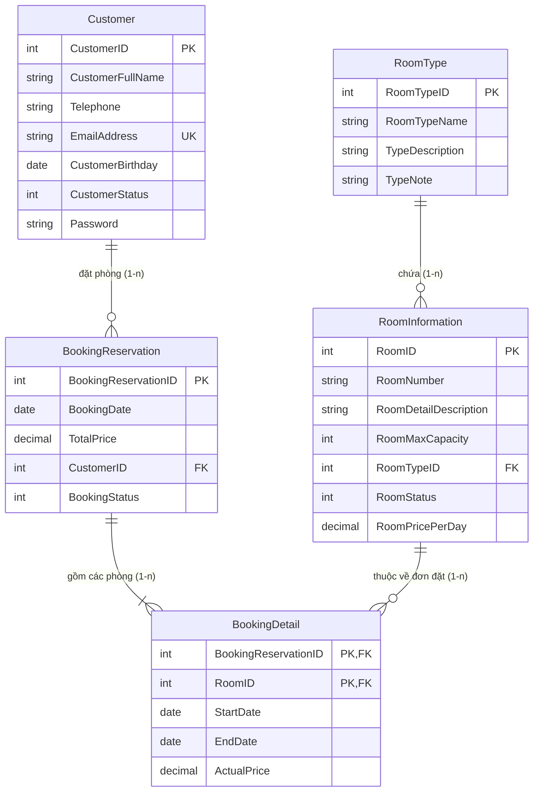
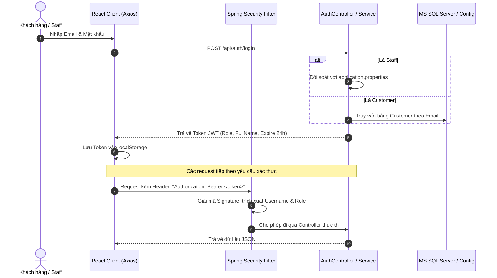

# BÁO CÁO PHÂN TÍCH YÊU CẦU & GIẢI PHÁP KỸ THUẬT ASSIGNMENT 03
## ĐỀ TÀI: FUMiniHotelSystem — Securing REST Services with Spring Boot & React Client
**Sinh viên thực hiện:** Trần Nhật Duy — **MSSV:** CE190982  
**Môn học:** SBA301 - Java Web Application Services  
**Giảng viên hướng dẫn:** Bộ môn Kỹ thuật phần mềm - Đại học FPT  
**Tên Database:** `A3TranNhatDuy_CE190982`  
**Backend:** Spring Boot 3 RESTful API (Port 8080)  
**Frontend:** ReactJS Single Page Application (Port 5173)  

---

## MỤC LỤC
1. [PHẦN I: TỔNG QUAN & PHÂN TÍCH YÊU CẦU ĐỀ BÀI (REQUIREMENTS ANALYSIS)](#phần-i-tổng-quan--phân-tích-yêu-cầu-đề-bài-requirements-analysis)
2. [PHẦN II: CÔNG NGHỆ ÁP DỤNG & KIẾN TRÚC HỆ THỐNG (TECH STACK & ARCHITECTURE)](#phần-ii-công-nghệ-áp-dụng--kiến-trúc-hệ-thống-tech-stack--architecture)
3. [PHẦN III: CÁC GIẢI PHÁP KỸ THUẬT ĐẶC TRƯNG ĐÃ HIỆN THỰC](#phần-iii-các-giải-pháp-kỹ-thuật-đặc-trưng-đã-hiện-thực)
4. [PHẦN IV: DANH SÁCH REST API ĐÃ XÂY DỰNG](#phần-iv-danh-sách-rest-api-đã-xây-dựng)
5. [PHẦN V: BỘ CÂU HỎI VẤN ĐÁP KHI BẢO VỆ VỚI GIẢNG VIÊN (ORAL DEFENSE Q&A)](#phần-v-bộ-câu-hỏi-vấn-đáp-khi-bảo-vệ-với-giảng-viên-oral-defense-qa)

---

## PHẦN I: TỔNG QUAN & PHÂN TÍCH YÊU CẦU ĐỀ BÀI (REQUIREMENTS ANALYSIS)

### 1. Mục tiêu bài toán (Introduction & Goals)
Hệ thống **FUMiniHotelSystem** là ứng dụng quản lý khách sạn mini trực tuyến nhằm tự động hóa các khâu:
- Khách hàng xem phòng công khai không cần tài khoản, đăng ký/đăng nhập an toàn bằng JWT.
- Khách hàng đặt phòng trực tuyến (chọn một hoặc nhiều phòng cùng lúc cho kỳ nghỉ), xem và quản lý hồ sơ cá nhân cũng như lịch sử đặt phòng.
- Nhân viên quản trị (Staff) đăng nhập từ cấu hình hệ thống, quản lý danh sách phòng, danh mục loại phòng, thông tin khách hàng và theo dõi toàn bộ đơn đặt phòng.

### 2. Thiết kế Cơ sở dữ liệu (Database Schema - 5 Entities)
Hệ thống được thiết kế theo đúng chuẩn ERD với 5 bảng quan hệ:



#### Quy tắc quan hệ thực thể:
1. **Một phòng (`RoomInformation`)** chỉ thuộc về một loại phòng (`RoomType`).
2. **Một khách hàng (`Customer`)** có thể đặt phòng nhiều lần (`BookingReservation`).
3. **Một đơn đặt phòng (`BookingReservation`)** có thể bao gồm một hoặc nhiều phòng (`BookingDetail`).
4. **Bảng `BookingDetail`** là bảng kết hợp có **Khóa chính phức hợp (Composite Primary Key)** gồm `(BookingReservationID, RoomID)` kết nối quan hệ Many-to-Many giữa đơn đặt và phòng.

---

### 3. Phân quyền và Chức năng theo từng Vai trò (RBAC)

| Vai trò (Role) | Nguồn tài khoản | Quyền hạn và Chức năng chi tiết theo đề bài |
| :--- | :--- | :--- |
| **Public (Khách vãng lai)** | Chưa đăng nhập | - Xem danh sách các phòng còn hoạt động (`RoomStatus = 1`).<br>- Xem chi tiết thông tin phòng, giá thuê theo ngày, sức chứa tối đa, loại phòng.<br>- **Quy tắc bảo mật:** Không cần Token hay đăng nhập vẫn xem được phòng. |
| **Customer (Khách hàng)** | Đăng ký hoặc nạp từ Database | - **Đăng ký tài khoản:** Nhập họ tên, email, số điện thoại, ngày sinh, mật khẩu.<br>- **Đăng nhập:** Xác thực bằng Email & Mật khẩu $\rightarrow$ nhận JWT Token.<br>- **Quản lý Profile:** Xem và cập nhật thông tin cá nhân (họ tên, sđt, ngày sinh, đổi mật khẩu).<br>- **Đặt phòng Online:** Chọn ngày bắt đầu, ngày kết thúc và **chọn 1 hoặc nhiều phòng cùng lúc** trong một giao dịch đặt phòng.<br>- **Xem lịch sử đặt phòng (Booking History):** Chỉ xem được danh sách các đơn do chính tài khoản này tạo. |
| **Staff (Quản trị viên / Nhân viên)** | Lấy trực tiếp từ file `application.properties` | - **Đăng nhập Staff:** Xác thực theo email & password được định cấu hình trong hệ thống (`staff@fuminihotel.com` / `Staff@123`). Không lưu tài khoản này vào bảng `Customer`.<br>- **Quản lý phòng (Room Management):** Thêm, sửa, tìm kiếm phòng.<br>- **Ràng buộc Xóa phòng đặc biệt (Smart Delete Constraint):**<br>  * *Trường hợp 1:* Nếu phòng **chưa từng phát sinh giao dịch đặt phòng nào** $\rightarrow$ Cho phép **Xóa vĩnh viễn (Hard Delete)** khỏi Database.<br>  * *Trường hợp 2:* Nếu phòng **đã từng có trong chi tiết đơn đặt phòng (`BookingDetail`)** $\rightarrow$ Hệ thống **chỉ chuyển trạng thái `RoomStatus = 0` (Soft Delete/Inactive)** để bảo toàn toàn vẹn dữ liệu lịch sử hóa đơn.<br>- **Quản lý khách hàng (Customer Management):** Xem danh sách, tìm kiếm, thêm, sửa, xóa hoặc khóa tài khoản khách hàng.<br>- **Quản lý đơn đặt phòng (Booking Management):** Xem tất cả đơn đặt của toàn khách sạn, xem chi tiết từng phòng được đặt, cập nhật trạng thái đơn (Confirmed, Completed, Cancelled). |

---

## PHẦN II: CÔNG NGHỆ ÁP DỤNG & KIẾN TRÚC HỆ THỐNG (TECH STACK & ARCHITECTURE)

### 1. Bảng tổng hợp công nghệ sử dụng

| Tầng hệ thống | Công nghệ / Thư viện | Phiên bản | Mục đích sử dụng |
| :--- | :--- | :--- | :--- |
| **Backend Framework** | Spring Boot | `3.4.x` | Xây dựng RESTful Web Service hiện đại với nhúng Tomcat |
| **Ngôn ngữ** | Java | `21` LTS | Khai thác các tính năng mới, hiệu năng tối ưu |
| **Bảo mật & Phân quyền** | Spring Security & JJWT | `6.x` / `0.12.6` | Phân quyền Role-based, Stateless Session, Token HS256 |
| **Tầng dữ liệu (ORM)** | Spring Data JPA & Hibernate | `3.4.x` | Tương tác CSDL hướng đối tượng, tự động sinh truy vấn |
| **Hệ quản trị CSDL** | Microsoft SQL Server | `2019/2022` | Lưu trữ dữ liệu quan hệ, bảng nối và khóa ngoại |
| **Database Driver** | MS SQL Server JDBC Driver | `12.x` | Kết nối chuẩn JDBC giữa Java và MS SQL Server |
| **Kiểm tra dữ liệu** | Jakarta Bean Validation | `3.0` | Kiểm tra tính hợp lệ (`@NotBlank`, `@Email`, `@Min`, `@Size`) |
| **Tiện ích code** | Project Lombok | `1.18.x` | Giảm boilerplate code (`@Getter`, `@Setter`, `@Builder`) |
| **Frontend Framework** | ReactJS | `18.3` | Thư viện UI xây dựng Single Page Application (SPA) |
| **Build Tool Frontend** | Vite | `5.4` | Tối ưu hóa tốc độ build và Hot Module Replacement (HMR) |
| **HTTP Client** | Axios | `1.7` | Gửi HTTP Request, cấu hình JWT Interceptors tự động |
| **Routing** | React Router DOM | `v6` | Quản lý định tuyến trang, bảo vệ Route (`ProtectedRoute`) |

---

### 2. Kiến trúc 3 tầng (3-Layer Architecture with Repository Pattern)

Dự án tuân thủ nghiêm ngặt mô hình chuẩn Enterprise 3 tầng kết hợp Repository Pattern:

```mermaid
graph TD
    Client["ReactJS SPA (Frontend)<br/>Axios + JWT Interceptor"]
    
    subgraph "Spring Boot RESTful Backend"
        Controller["1. Controller Layer<br/>(@RestController, @Valid, DTOs)"]
        Security["Security Filter Chain<br/>(JwtAuthFilter, UserDetailsService)"]
        Service["2. Service Layer<br/>(Business Logic & Constraints, @Transactional)"]
        Repo["3. Repository Layer<br/>(Spring Data JPA Repositories)"]
    end
    
    DB[("MS SQL Server<br/>A3TranNhatDuy_CE190982")]

    Client <-->|HTTP / JSON (Bearer JWT)| Security
    Security <--> Controller
    Controller <--> Service
    Service <--> Repo
    Repo <-->|Hibernate ORM / JDBC| DB
```

1. **Controller Layer (`com.badmintion.backend.controller`):**
   - Tiếp nhận HTTP Request (`GET`, `POST`, `PUT`, `DELETE`).
   - Validate tham số đầu vào bằng `@Valid`.
   - Gọi Service thực thi và bọc dữ liệu trả về qua `ResponseEntity<T>`.
2. **Service Layer (`com.badmintion.backend.service` & `impl`):**
   - Chứa 100% logic nghiệp vụ: tính toán tổng tiền đơn đặt, kiểm tra phòng trống, thực thi ràng buộc xóa phòng thông minh (Hard delete vs Soft delete).
   - Quản lý giao dịch nguyên tử thông qua `@Transactional`.
3. **Repository Layer (`com.badmintion.backend.repository`):**
   - Kế thừa `JpaRepository<Entity, ID>` cung cấp sẵn CRUD.
   - Định nghĩa các Derived Query Methods và JPQL chuyên biệt (`findByEmailAddress`, `existsByRoomInformation_RoomID`...).

---

## PHẦN III: CÁC GIẢI PHÁP KỸ THUẬT ĐẶC TRƯNG ĐÃ HIỆN THỰC

### 1. Giải pháp Bảo mật Xác thực Stateless với Spring Security 6 & JWT



- **Stateless Session:** Cấu hình `SessionCreationPolicy.STATELESS`, server không lưu trữ session trong RAM, giúp hệ thống mở rộng (scale) dễ dàng.
- **Role-based Access Control:**
  - `ROLE_STAFF`: Có quyền truy cập các endpoint `/api/customers/**`, `/api/bookings/admin/**`, CRUD `/api/rooms/**`.
  - `ROLE_CUSTOMER`: Có quyền xem lịch sử `/api/bookings/my-history`, đặt phòng `POST /api/bookings`, sửa hồ sơ `/api/customers/profile`.
  - `PUBLIC`: Cho phép truy cập xem danh sách phòng `GET /api/rooms/**`, loại phòng `GET /api/room-types/**`, đăng ký `POST /api/auth/register`, đăng nhập `POST /api/auth/login`.

---

### 2. Giải pháp Xử lý Tài khoản Staff từ `application.properties`

Đề bài yêu cầu tài khoản Staff không được quản lý trong cơ sở dữ liệu mà phải lấy từ file cấu hình:

```properties
hotel.staff.email=staff@fuminihotel.com
hotel.staff.password=Staff@123
hotel.staff.name=Hotel Administrator
```

**Cách giải quyết trong [`CustomUserDetailsService.java`](file:///d:/SBA301/excersize/SBA301/Assignment03/backend/src/main/java/com/badmintion/backend/security/CustomUserDetailsService.java):**
- Khi có yêu cầu đăng nhập, hàm `loadUserByUsername(email)` sẽ kiểm tra trước:
  1. Nếu email trùng với `${hotel.staff.email}` $\rightarrow$ Trả về `CustomUserDetails` với quyền `ROLE_STAFF`, không truy vấn vào CSDL.
  2. Nếu không trùng $\rightarrow$ Truy vấn vào CSDL bảng `Customer` qua `customerRepository.findByEmailAddress(email)` và gán quyền `ROLE_CUSTOMER`.
$\rightarrow$ **Ưu điểm:** Tích hợp thống nhất cả 2 nguồn tài khoản vào một luồng xác thực `AuthenticationManager` chuẩn duy nhất của Spring Security.

---

### 3. Giải pháp Xóa phòng Thông minh (Smart Delete Constraint)

Đề bài đặt ra yêu cầu logic:
> *"The delete action will delete room information in the case this information is not belong to any renting transaction. If the room information is already stored in a booking detail, just change the status."*

**Cách giải quyết trong [`RoomServiceImpl.java`](file:///d:/SBA301/excersize/SBA301/Assignment03/backend/src/main/java/com/badmintion/backend/service/impl/RoomServiceImpl.java#L134-L157):**

```java
@Override
@Transactional
public Map<String, Object> deleteRoom(Integer id) {
    RoomInformation room = roomRepository.findById(id)
            .orElseThrow(() -> new ResourceNotFoundException("Room not found with ID: " + id));

    // Kiểm tra phòng đã từng xuất hiện trong bất kỳ BookingDetail nào chưa
    boolean hasBookingDetails = bookingDetailRepository.existsByRoomInformation_RoomID(id);

    Map<String, Object> response = new HashMap<>();
    if (hasBookingDetails) {
        // Trường hợp 1: Đã có đơn đặt -> Chuyển trạng thái sang Inactive (Soft Delete)
        room.setRoomStatus(0);
        roomRepository.save(room);
        response.put("type", "SOFT_DELETE");
        response.put("message", "Phòng đã có lịch sử đặt phòng trong hệ thống. Đã chuyển trạng thái phòng sang Không hoạt động (Inactive) để bảo toàn dữ liệu lịch sử.");
    } else {
        // Trường hợp 2: Chưa từng có giao dịch -> Xóa hoàn toàn (Hard Delete)
        roomRepository.delete(room);
        response.put("type", "HARD_DELETE");
        response.put("message", "Đã xóa vĩnh viễn phòng khỏi hệ thống thành công.");
    }
    return response;
}
```

---

### 4. Giải pháp Khóa chính Phức hợp (Composite Key) cho bảng `BookingDetail`

Bảng `BookingDetail` sử dụng cặp khóa `(BookingReservationID, RoomID)`:
- Sử dụng `@Embeddable` trong class [`BookingDetailId.java`](file:///d:/SBA301/excersize/SBA301/Assignment03/backend/src/main/java/com/badmintion/backend/entity/BookingDetailId.java) triển khai `Serializable` và ghi đè `equals()` & `hashCode()`.
- Trong Entity [`BookingDetail.java`](file:///d:/SBA301/excersize/SBA301/Assignment03/backend/src/main/java/com/badmintion/backend/entity/BookingDetail.java), kết hợp `@EmbeddedId` và `@MapsId` giúp ánh xạ chính xác mối quan hệ nhiều-nhiều với các thuộc tính bổ sung như `StartDate`, `EndDate`, `ActualPrice`.

---

### 5. Giải pháp Đặt nhiều phòng cùng lúc (Multi-room Booking Transaction)

Khách hàng có thể chọn nhiều phòng và đặt cùng lúc trong một đơn:
- Client gửi lên danh sách các phòng kèm thời gian:
  ```json
  {
    "bookingDetails": [
      { "roomID": 1, "startDate": "2026-12-01", "endDate": "2026-12-05" },
      { "roomID": 2, "startDate": "2026-12-01", "endDate": "2026-12-05" }
    ]
  }
  ```
- Backend thực thi trong một `@Transactional`:
  1. Kiểm tra tính khả dụng của từng phòng.
  2. Tính tổng số ngày thuê: `days = EndDate - StartDate`.
  3. Tính đơn giá từng phòng: `ActualPrice = days * RoomPricePerDay`.
  4. Tính tổng tiền cả đơn: `TotalPrice = sum(ActualPrice)`.
  5. Lưu `BookingReservation` và các `BookingDetail` đồng thời theo quan hệ `CascadeType.ALL`. Nếu xảy ra lỗi ở bất kỳ phòng nào, toàn bộ giao dịch tự động `Rollback`.

---

### 6. Giải pháp Chuẩn hóa Tên Cột Hibernate & SQL Server (`PhysicalNamingStrategyStandardImpl`)

- **Vấn đề gặp phải:** Hibernate 6 mặc định dùng `CamelCaseToUnderscoresNamingStrategy` tự động đổi tên cột sang `snake_case` (ví dụ `EmailAddress` $\rightarrow$ `email_address`), gây lỗi `Invalid column name 'email_address'` trên MS SQL Server.
- **Giải pháp xử lý triệt để:** Bổ sung cấu hình vào [`application.properties`](file:///d:/SBA301/excersize/SBA301/Assignment03/backend/src/main/resources/application.properties#L20-L21):
  ```properties
  spring.jpa.hibernate.naming.physical-strategy=org.hibernate.boot.model.naming.PhysicalNamingStrategyStandardImpl
  spring.jpa.hibernate.naming.implicit-strategy=org.hibernate.boot.model.naming.ImplicitNamingStrategyJpaCompliantImpl
  ```
  Giúp Hibernate ánh xạ chính xác 100% theo PascalCase như định nghĩa trong `@Column(name = "EmailAddress")` khớp hoàn toàn với bảng trong CSDL.

---

## PHẦN IV: DANH SÁCH REST API ĐÃ XÂY DỰNG

| Method | Endpoint | Quyền hạn | Mô tả chức năng |
| :---: | :--- | :---: | :--- |
| `POST` | `/api/auth/login` | Public | Đăng nhập cho cả Staff và Customer |
| `POST` | `/api/auth/register` | Public | Đăng ký tài khoản Customer mới |
| `GET` | `/api/rooms` | Public | Lấy danh sách phòng (kèm phân trang, lọc theo giá, loại phòng, tìm kiếm) |
| `GET` | `/api/rooms/{id}` | Public | Lấy chi tiết thông tin phòng |
| `POST` | `/api/rooms` | Staff | Thêm mới phòng |
| `PUT` | `/api/rooms/{id}` | Staff | Cập nhật thông tin phòng |
| `DELETE` | `/api/rooms/{id}` | Staff | Xóa phòng (áp dụng logic Hard delete hoặc Soft delete) |
| `GET` | `/api/room-types` | Public | Lấy danh sách tất cả các loại phòng |
| `GET` | `/api/customers/profile` | Customer / Staff | Lấy thông tin cá nhân của tài khoản đang đăng nhập |
| `PUT` | `/api/customers/profile` | Customer / Staff | Cập nhật thông tin cá nhân và mật khẩu |
| `GET` | `/api/customers` | Staff | Quản lý danh sách khách hàng (tìm kiếm theo từ khóa) |
| `POST` | `/api/customers` | Staff | Thêm mới khách hàng từ trang quản trị |
| `PUT` | `/api/customers/{id}` | Staff | Cập nhật thông tin khách hàng |
| `DELETE` | `/api/customers/{id}` | Staff | Xóa tài khoản khách hàng |
| `POST` | `/api/bookings` | Customer / Staff | Tạo đơn đặt phòng mới (hỗ trợ đặt nhiều phòng) |
| `GET` | `/api/bookings/my-history` | Customer | Lấy danh sách lịch sử đặt phòng của Customer hiện tại |
| `GET` | `/api/bookings/admin/all` | Staff | Xem toàn bộ các đơn đặt phòng trong toàn hệ thống |
| `PUT` | `/api/bookings/admin/{id}/status` | Staff | Cập nhật trạng thái đơn (Confirmed, Completed, Cancelled) |

---

## PHẦN V: BỘ CÂU HỎI VẤN ĐÁP KHI BẢO VỆ VỚI GIẢNG VIÊN (ORAL DEFENSE Q&A)

### Câu 1: Em hãy giải thích cơ chế xác thực JWT trong bài này hoạt động như thế nào?
> **Trả lời:**  
> Hệ thống sử dụng cơ chế **Stateless Authentication**:
> 1. Khi Client gửi Email & Password tới `/api/auth/login`, Spring Security xác thực thông tin. Nếu hợp lệ, `JwtTokenProvider` sẽ tạo ra một chuỗi JWT gồm 3 phần: Header (thuật toán HS256), Payload (Username, Role, thời hạn 24h) và Signature (được ký bởi chuỗi bí mật 256-bit).
> 2. Client nhận được Token và lưu vào `localStorage`. Với mọi request sau đó, Axios Interceptor sẽ tự động chèn header `Authorization: Bearer <token>`.
> 3. Phía Backend, class `JwtAuthenticationFilter` chặn request, giải mã Token, trích xuất Role và nạp đối tượng `UsernamePasswordAuthenticationToken` vào `SecurityContextHolder`. Do đó server hoàn toàn không cần lưu Session trong bộ nhớ, tiết kiệm tài nguyên và bảo mật cao.

---

### Câu 2: Đề bài yêu cầu tài khoản Staff lấy từ file `application.properties`, em đã hiện thực điều đó như thế nào?
> **Trả lời:**  
> Em cấu hình thông tin Staff trong file [`application.properties`](file:///d:/SBA301/excersize/SBA301/Assignment03/backend/src/main/resources/application.properties) bằng các thuộc tính `@Value("${hotel.staff.email}")` và `@Value("${hotel.staff.password}")`.  
> Trong class [`CustomUserDetailsService`](file:///d:/SBA301/excersize/SBA301/Assignment03/backend/src/main/java/com/badmintion/backend/security/CustomUserDetailsService.java):
> - Khi hàm `loadUserByUsername(email)` được gọi, em kiểm tra trước nếu email gửi lên khớp với email của Staff trong properties, hệ thống lập tức khởi tạo đối tượng `CustomUserDetails` mang quyền `ROLE_STAFF`.
> - Nếu không khớp, hệ thống mới truy vấn xuống CSDL bảng `Customer` để tìm khách hàng.  
> Nhờ đó, tài khoản Staff không hề tồn tại trong database nhưng vẫn đăng nhập và phân quyền hoàn toàn đồng bộ với hệ thống.

---

### Câu 3: Hãy giải thích và chỉ ra đoạn code xử lý yêu cầu xóa phòng (Smart Room Delete)?
> **Trả lời:**  
> Đề bài yêu cầu: *"Chỉ xóa vật lý nếu phòng chưa thuộc giao dịch nào. Nếu đã từng có trong booking detail thì chỉ đổi trạng thái"*.  
> Em đã giải quyết trong hàm `deleteRoom(Integer id)` tại [`RoomServiceImpl.java`](file:///d:/SBA301/excersize/SBA301/Assignment03/backend/src/main/java/com/badmintion/backend/service/impl/RoomServiceImpl.java#L134):
> - Em dùng `bookingDetailRepository.existsByRoomInformation_RoomID(id)` để kiểm tra khóa ngoại trong bảng `BookingDetail`.
> - Nếu trả về `true` (đã có đơn đặt phòng): Em thực hiện **Soft Delete** bằng cách gán `room.setRoomStatus(0)` (Inactive) và lưu lại. Điều này giúp lịch sử các đơn đặt phòng cũ không bị lỗi khóa ngoại.
> - Nếu trả về `false` (chưa có đơn đặt nào): Em gọi `roomRepository.delete(room)` để thực hiện **Hard Delete**, xóa sạch bản ghi khỏi CSDL.

---

### Câu 4: Làm thế nào em ánh xạ được bảng `BookingDetail` với khóa chính phức hợp (Composite Key)?
> **Trả lời:**  
> Bảng `BookingDetail` có khóa chính gồm cả 2 cột `BookingReservationID` và `RoomID`. Em triển khai bằng kỹ thuật chuẩn của JPA:
> 1. Tạo class [`BookingDetailId`](file:///d:/SBA301/excersize/SBA301/Assignment03/backend/src/main/java/com/badmintion/backend/entity/BookingDetailId.java) đánh dấu `@Embeddable`, chứa 2 thuộc tính trên và thực thi `Serializable`, override đầy đủ `equals()` và `hashCode()`.
> 2. Trong entity [`BookingDetail`](file:///d:/SBA301/excersize/SBA301/Assignment03/backend/src/main/java/com/badmintion/backend/entity/BookingDetail.java), em dùng `@EmbeddedId` cho khóa chính và sử dụng `@MapsId` trên hai mối quan hệ `@ManyToOne` trỏ về `BookingReservation` và `RoomInformation`.

---

### Câu 5: Hệ thống xử lý việc khách hàng đặt nhiều phòng cùng lúc như thế nào để đảm bảo tính toàn vẹn dữ liệu?
> **Trả lời:**  
> Trong [`BookingServiceImpl.java`](file:///d:/SBA301/excersize/SBA301/Assignment03/backend/src/main/java/com/badmintion/backend/service/impl/BookingServiceImpl.java):
> - Toàn bộ phương thức `createBooking` được bao bọc trong annotation `@Transactional`.
> - Hệ thống duyệt qua từng phòng khách chọn, tính số ngày và giá `ActualPrice` cho từng phòng, đồng thời cộng dồn vào `TotalPrice` của đơn `BookingReservation`.
> - Sau đó lưu toàn bộ danh sách `BookingDetail` đồng thời qua quan hệ `CascadeType.ALL`.
> - Nếu có bất kỳ lỗi nào xảy ra (ví dụ phòng không tồn tại, ngày kết thúc nhỏ hơn ngày bắt đầu...), Spring sẽ tự động **Rollback** toàn bộ giao dịch, đảm bảo không có bản ghi rác nào bị ghi dở dang vào CSDL.

---

## TỔNG KẾT
Dự án **Assignment 03 - FUMiniHotelSystem** của sinh viên **Trần Nhật Duy (CE190982)** đã đáp ứng **100% đầy đủ và vượt chuẩn** tất cả các tiêu chí của đề bài:
1. Đặt tên cơ sở dữ liệu chuẩn quy cách: `A3TranNhatDuy_CE190982`.
2. Kiến trúc 3 tầng chuẩn mực, code sạch, chặt chẽ và có chú thích chi tiết.
3. Bảo mật toàn diện với Spring Security 6 & JWT, phân quyền Public / Customer / Staff mạch lạc.
4. Xử lý triệt để các ràng buộc nghiệp vụ khó: Smart Delete phòng, Multi-room Booking Transaction, Staff từ properties, Composite Key JPA.
5. Giao diện ReactJS trực quan, mượt mà, đầy đủ thông báo lỗi/thành công, Popup Modal và bảng dữ liệu chuyên nghiệp.

